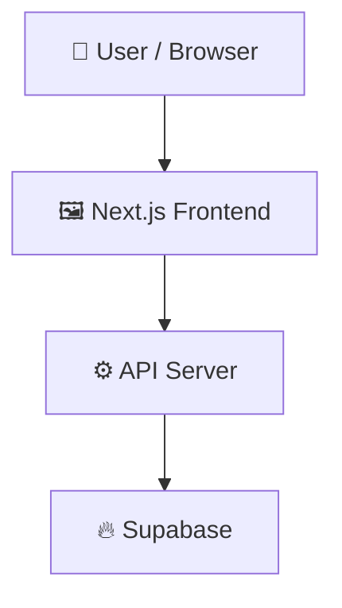

# loopwork

> Vendor guest post price comparison and indexing tracking portal

 

## 📑 Table of Contents

- [Description](#description)
- [Key Features](#key-features)
- [Use Cases](#use-cases)
- [Tech Stack](#tech-stack)
- [Architecture](#architecture)
- [Quick Start](#quick-start)
- [Environment Variables](#environment-variables)
- [Key Dependencies](#key-dependencies)
- [Available Scripts](#available-scripts)
- [API Endpoints](#api-endpoints)
- [Project Structure](#project-structure)
- [Development Setup](#development-setup)
- [Deployment](#deployment)
- [Contributors](#contributors)
- [Contributing](#contributing)
- [License](#license)

## 📝 Description

loopwork (Guest Post Portal) is a full-stack platform designed to track, compare, and manage guest post opportunities across multiple vendors. It solves the problem of scattered vendor price lists and order duplication by letting administrators identify which vendor offers the lowest price for a specific website, monitor previous link purchases, and verify that published links remain indexed in Google search results.

## ✨ Key Features

- **📒 Vendor Ledger & Multi-Tab Synchronization** — Synchronizes vendor-bound Google Sheets across month tabs (e.g. July, August Links) and payment history tabs. Calculates total bought links and payments in PKR, strictly ignoring non-link rows and summary cells.
- **✍️ Google Sheets Index Status Write-Back** — Automatically writes "Indexed" or "Not indexed" back into the vendor's Google Sheet Status column via `batchUpdate` when Serper checks run. *(Requires Editor role on the sheet; Viewer is sufficient for read-only sync)*.
- **📅 Dynamic Month & Week Inference** — Infers months from tab names and calculates Monday-based weeks in `Asia/Karachi`. Automatically supports new month tabs.
- **🔍 Vendor Price Comparison** — Searches guest post websites and ranks vendors offering placements from cheapest to most expensive.
- **📊 All Listings Rebuild & Segmented Views** — Admin tab strip with per-vendor tabs, segmented views for "Links bought (Ledger)" and "Price list", filters by month, week, tab, and search query, with real-time totals and balance cards.
- **🔎 Google Index Status Verification** — Checks whether purchased guest post links are indexed in Google search results using the Serper API.
- **🔒 Row Level Security Auth** — Uses Supabase authentication and PostgreSQL Row Level Security to restrict vendors to their own listings while granting full access to admins.
- **⏱️ Automated Sync Cron Jobs** — Periodically synchronizes data using configured Vercel cron jobs secured by a shared secret.
- **📱 Progressive Web App Support** — Lightweight PWA capabilities with install prompt appearing only when installable.

## 🎯 Use Cases

- Comparing guest post listing prices across multiple SEO vendors to secure the lowest rate
- Preventing duplicate link purchases by auditing existing order histories before placing new orders
- Monitoring Google indexing status for live backlink placements without manual search scraping
- Providing vendors a scoped portal to view only their own active listings and placed orders

## 🛠️ Tech Stack

   

## 🏗️ Architecture

A high-level view of how the main pieces fit together:



## 📦 Key Dependencies

```
@supabase/ssr: ^0.7.0
@supabase/supabase-js: ^2.57.0
google-auth-library: ^9.15.0
next: ^15.5.0
react: ^19.1.0
react-dom: ^19.1.0
server-only: ^0.0.1
```

## 📁 Project Structure

```
.
├── .env.example
├── LICENSE
├── app
│   ├── (app)
│   │   ├── admin
│   │   │   ├── layout.tsx
│   │   │   ├── orders
│   │   │   │   ├── [id]
│   │   │   │   │   └── ...
│   │   │   │   ├── new
│   │   │   │   │   └── ...
│   │   │   │   └── page.tsx
│   │   │   ├── payments
│   │   │   │   └── page.tsx
│   │   │   ├── sheets
│   │   │   │   ├── [id]
│   │   │   │   │   └── ...
│   │   │   │   ├── new
│   │   │   │   │   └── ...
│   │   │   │   └── page.tsx
│   │   │   └── vendors
│   │   │       └── page.tsx
│   │   ├── layout.tsx
│   │   ├── listings
│   │   │   └── page.tsx
│   │   ├── orders
│   │   │   └── page.tsx
│   │   ├── page.tsx
│   │   ├── payments
│   │   │   └── page.tsx
│   │   └── search
│   │       ├── bulk
│   │       │   └── page.tsx
│   │       └── page.tsx
│   ├── actions
│   │   ├── auth.ts
│   │   ├── orders.ts
│   │   ├── payments.ts
│   │   ├── sheets.ts
│   │   └── vendors.ts
│   ├── api
│   │   ├── admin
│   │   │   ├── sheet-headers
│   │   │   │   └── route.ts
│   │   │   └── sheet-tabs
│   │   │       └── route.ts
│   │   ├── cron
│   │   │   ├── index-check
│   │   │   │   └── route.ts
│   │   │   └── sync
│   │   │       └── route.ts
│   │   └── search
│   │       └── bulk
│   │           └── route.ts
│   ├── error.tsx
│   ├── globals.css
│   ├── layout.tsx
│   ├── login
│   │   ├── LoginForm.tsx
│   │   └── page.tsx
│   └── manifest.ts
├── components
│   ├── ActionButton.tsx
│   ├── ActionForm.tsx
│   ├── BulkSearch.tsx
│   ├── InstallPrompt.tsx
│   ├── LedgerPreviewModal.tsx
│   ├── NavLinks.tsx
│   ├── OrderFields.tsx
│   ├── Pager.tsx
│   ├── PwaRegister.tsx
│   ├── SearchBox.tsx
│   ├── SheetForm.tsx
│   ├── SheetPreviewButton.tsx
│   └── StatusBadge.tsx
├── lib
│   ├── auth.ts
│   ├── config.ts
│   ├── domain.ts
│   ├── fields.ts
│   ├── form.ts
│   ├── format.ts
│   ├── indexing.ts
│   ├── ledger.ts
│   ├── parse.ts
│   ├── search.ts
│   ├── sheets-types.ts
│   ├── sheets.ts
│   ├── supabase
│   │   ├── admin.ts
│   │   └── server.ts
│   ├── sync.ts
│   └── types.ts
├── middleware.ts
├── next.config.mjs
├── package.json
├── postcss.config.mjs
├── public
│   ├── favicon.png
│   ├── icons
│   │   ├── apple-touch-icon.png
│   │   ├── icon-192.png
│   │   ├── icon-512.png
│   │   └── maskable-512.png
│   ├── offline.html
│   └── sw.js
├── scripts
│   ├── seed-admin.mjs
│   └── test-ledger.mjs
├── supabase
│   └── migrations
│       ├── 0001_init.sql
│       ├── 0002_pkr_payments_tabs.sql
│       ├── 0003_order_pair_article.sql
│       ├── 0004_payment_status_and_alerts.sql
│       └── 0005_vendor_ledger.sql
├── tailwind.config.ts
├── tsconfig.json
└── vercel.json
```

## ⚡ Available Scripts

- `npm run dev` — Starts the local Next.js development server
- `npm run build` — Compiles and builds the production Next.js application
- `npm test` — Runs the unit test suite (`tsx scripts/test-ledger.mjs`) verifying ledger parsing, week helpers, month inference, and writeback logic
- `npm run seed:admin` — Seeds initial admin user credentials (`scripts/seed-admin.mjs`)

## 🧪 Testing & Verification

Run the test suite:
```bash
npm test
```

Expected output:
```
--- Testing Month Inference ---
✓ Month inference passed.
--- Testing Week Helpers ---
✓ Week helpers passed.
--- Testing Date & Domain Helpers ---
✓ Date and domain helpers passed.
--- Testing August Tab Fixture (Section 2 & 9) ---
✓ August tab fixture passed! Total PKR 47,000 verified.
--- Testing Payment History Fixture ---
✓ Payment history fixture passed! Total PKR 40,000 verified.
--- Testing Balance Calculation & Preview ---
✓ Resulting balance 7,000 PKR verified.
--- Testing Write-Back Ranges (Section 9) ---
✓ Write-back ranges test passed! F12 updated and idempotent on second run.

ALL FIXTURE TESTS PASSED SUCCESSFULLY! 🎉
```

Run TypeScript and production build checks:
```bash
npx tsc --noEmit
npm run build
```

## 🔒 Google Sheets Write-Back & Permissions

- **Read-Only Syncing:** The Google Service Account only requires **Viewer** access to sync vendor sheets, price lists, and order histories.
- **Status Write-Back (`write_status_back = true`):** When enabled, Serper index check results (`Indexed` or `Not indexed`) are written back to the `Status` column in the vendor's Google Sheet. This requires the sheet to be shared with the Service Account email as **Editor**.
- **Graceful Failure:** If write-back is attempted on a sheet with Viewer permissions, the index check itself still completes successfully, and an informative warning is logged on the sheet source prompting the admin to grant Editor access.

## 📌 Implementation Assumptions

1. **Vendor Ledger Implication:** Each vendor spreadsheet represents bought links for that vendor. The vendor is identified by the spreadsheet binding, so there is no Vendor column inside the sheet.
2. **Order Filtering:** Only rows with a valid URL in the Live link column are counted as orders. Summary rows (e.g. orange total row `20000`, green remaining row `1500`, label rows) are discarded.
3. **No Price Fallback for Ledgers:** For ledger sheets, order prices are read directly from column B of that row. If empty or non-numeric, `price_paid` is set to `null` (0 PKR) without looking up prices in the vendor's price list.
4. **Duplicate Live URLs:** If the same live link appears across multiple tabs in a ledger, the later tab takes precedence, and earlier occurrences are recorded as duplicate skips.
5. **Effective Date for Filtering:** Month and week filtering uses the order's parsed Date. If the Date cell is empty, the filter falls back to the tab's inferred month (`order_month`, 1st of month).
6. **Week Start & Timezone:** All week calculations start on Monday and are evaluated in the `Asia/Karachi` timezone (UTC+5).
7. **Exclusion of Running Totals:** Any column in the Payment History tab matching `/remain|balance|total|due|left/i` is excluded from payment amount detection to prevent double-counting.
8. **Write-Back Values:** Exact strings `"Indexed"` and `"Not indexed"` are written. Pending checks are never written back.

## 🚢 Deployment

### Vercel

This project is configured for [Vercel](https://vercel.com). Push to the connected branch or run `vercel` locally. Make sure to run `supabase/migrations/0005_vendor_ledger.sql` in your Supabase SQL Editor.

## 👥 Contributors

Thanks to everyone who has contributed to this project:

<p align="left">
<a href="https://github.com/MukaramCodes" title="MukaramCodes"></a>
<a href="https://github.com/luffy-loop-admin" title="luffy-loop-admin"></a>
</p>

[See the full list of contributors →](https://github.com/luffy-loop-admin/loopwork/graphs/contributors)

## 📜 License

This project is licensed under the **LICENSE** License.

---

<div align="center">

