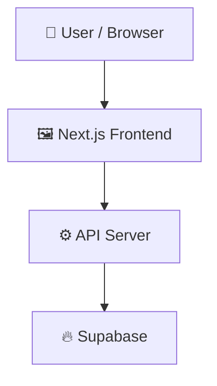

# loopwork

> Vendor guest post price comparison and indexing tracking portal

 

## 📑 Table of Contents

- [Description](#description)
- [Key Features](#key-features)
- [Use Cases](#use-cases)
- [Tech Stack](#tech-stack)
- [Architecture](#architecture)
- [Quick Start](#quick-start)
- [Environment Variables](#environment-variables)
- [Key Dependencies](#key-dependencies)
- [Available Scripts](#available-scripts)
- [API Endpoints](#api-endpoints)
- [Project Structure](#project-structure)
- [Development Setup](#development-setup)
- [Deployment](#deployment)
- [Contributors](#contributors)
- [Contributing](#contributing)
- [License](#license)

## 📝 Description

loopwork (Guest Post Portal) is a full-stack platform designed to track, compare, and manage guest post opportunities across multiple vendors. It solves the problem of scattered vendor price lists and order duplication by letting administrators identify which vendor offers the lowest price for a specific website, monitor previous link purchases, and verify that published links remain indexed in Google search results.

## ✨ Key Features

- **🔍 Vendor Price Comparison** — Searches guest post websites and ranks vendors offering placements from cheapest to most expensive.
- **📊 Google Sheets Synchronization** — Imports vendor price lists and previous order histories using a Google Service Account integration.
- **🔎 Google Index Status Verification** — Checks whether purchased guest post links are indexed in Google search results using the Serper API.
- **🔒 Row Level Security Auth** — Uses Supabase authentication and PostgreSQL Row Level Security to restrict vendors to their own listings while granting full access to admins.
- **⏱️ Automated Sync Cron Jobs** — Periodically synchronizes data using configured Vercel cron jobs secured by a shared secret.
- **📱 Progressive Web App Support** — Provides mobile web application capabilities and web app icons via a dedicated PWA registration component.

## 🎯 Use Cases

- Comparing guest post listing prices across multiple SEO vendors to secure the lowest rate
- Preventing duplicate link purchases by auditing existing order histories before placing new orders
- Monitoring Google indexing status for live backlink placements without manual search scraping
- Providing vendors a scoped portal to view only their own active listings and placed orders

## 🛠️ Tech Stack

   

## 🏗️ Architecture

A high-level view of how the main pieces fit together:



## 📦 Key Dependencies

```
@supabase/ssr: ^0.7.0
@supabase/supabase-js: ^2.57.0
google-auth-library: ^9.15.0
next: ^15.5.0
react: ^19.1.0
react-dom: ^19.1.0
server-only: ^0.0.1
```

## 📁 Project Structure

```
.
├── .env.example
├── LICENSE
├── app
│   ├── (app)
│   │   ├── admin
│   │   │   ├── layout.tsx
│   │   │   ├── orders
│   │   │   │   ├── [id]
│   │   │   │   │   └── ...
│   │   │   │   ├── new
│   │   │   │   │   └── ...
│   │   │   │   └── page.tsx
│   │   │   ├── payments
│   │   │   │   └── page.tsx
│   │   │   ├── sheets
│   │   │   │   ├── [id]
│   │   │   │   │   └── ...
│   │   │   │   ├── new
│   │   │   │   │   └── ...
│   │   │   │   └── page.tsx
│   │   │   └── vendors
│   │   │       └── page.tsx
│   │   ├── layout.tsx
│   │   ├── listings
│   │   │   └── page.tsx
│   │   ├── orders
│   │   │   └── page.tsx
│   │   ├── page.tsx
│   │   ├── payments
│   │   │   └── page.tsx
│   │   └── search
│   │       ├── bulk
│   │       │   └── page.tsx
│   │       └── page.tsx
│   ├── actions
│   │   ├── auth.ts
│   │   ├── orders.ts
│   │   ├── payments.ts
│   │   ├── sheets.ts
│   │   └── vendors.ts
│   ├── api
│   │   ├── admin
│   │   │   └── sheet-headers
│   │   │       └── route.ts
│   │   ├── cron
│   │   │   ├── index-check
│   │   │   │   └── route.ts
│   │   │   └── sync
│   │   │       └── route.ts
│   │   └── search
│   │       └── bulk
│   │           └── route.ts
│   ├── error.tsx
│   ├── globals.css
│   ├── layout.tsx
│   ├── login
│   │   ├── LoginForm.tsx
│   │   └── page.tsx
│   └── manifest.ts
├── components
│   ├── ActionButton.tsx
│   ├── ActionForm.tsx
│   ├── BulkSearch.tsx
│   ├── InstallPrompt.tsx
│   ├── NavLinks.tsx
│   ├── OrderFields.tsx
│   ├── Pager.tsx
│   ├── PwaRegister.tsx
│   ├── SearchBox.tsx
│   ├── SheetForm.tsx
│   └── StatusBadge.tsx
├── lib
│   ├── auth.ts
│   ├── config.ts
│   ├── domain.ts
│   ├── fields.ts
│   ├── form.ts
│   ├── format.ts
│   ├── indexing.ts
│   ├── parse.ts
│   ├── search.ts
│   ├── sheets.ts
│   ├── supabase
│   │   ├── admin.ts
│   │   └── server.ts
│   ├── sync.ts
│   └── types.ts
├── middleware.ts
├── next.config.mjs
├── package.json
├── postcss.config.mjs
├── public
│   ├── favicon.png
│   ├── icons
│   │   ├── apple-touch-icon.png
│   │   ├── icon-192.png
│   │   ├── icon-512.png
│   │   └── maskable-512.png
│   ├── offline.html
│   └── sw.js
├── scripts
│   └── seed-admin.mjs
├── tailwind.config.ts
├── tsconfig.json
└── vercel.json
```

## 🚢 Deployment

### Vercel

This project is configured for [Vercel](https://vercel.com). Push to the connected branch or run `vercel` locally.

## 👥 Contributors

Thanks to everyone who has contributed to this project:

<p align="left">
<a href="https://github.com/MukaramCodes" title="MukaramCodes"></a>
<a href="https://github.com/luffy-loop-admin" title="luffy-loop-admin"></a>
</p>

[See the full list of contributors →](https://github.com/luffy-loop-admin/loopwork/graphs/contributors)

## 📜 License

This project is licensed under the **LICENSE** License.

---

<div align="center">

